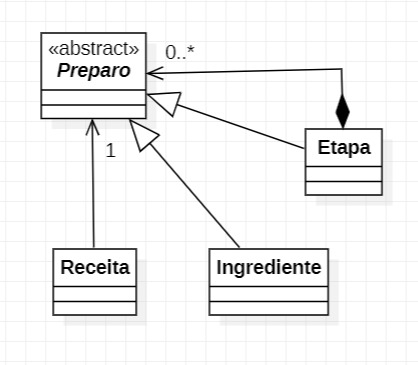

# Exercício Composite, Receita de bolo
#### Nome: João Vitor Fernandes Ribeiro Carneiro Ramos
#### Matrícula: 202165076C

Implementação do padrão de projeto **Composite** em Java.

## Diagrama UML

